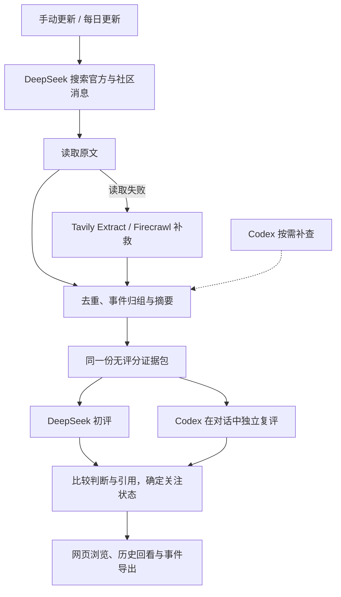

# 游戏事件雷达 · Game Event Radar

面向游戏运营的事件发现工具。从官方公告和社区消息中发现具体事件，追查出处、整理后续，再通过两次独立评分筛选值得关注的议题。

目前以《崩坏：星穹铁道》为默认场景，关注版本与关卡、角色强度、剧情、活动联动及运营动态。项目在本机运行，支持手动更新和每日更新。

## 页面展示

| 首页与今日关注 | 事件详情 |
| --- | --- |
|  |  |
| 独立双评分 | 材料追溯 |
|  |  |

## 从消息到事件

一条官宣、几篇转载、一段攻略讨论，可能都在讲同一件事。雷达将这些分散的消息整理到具体事件下，保留各自的出处和日期，方便查看事情的起因与后续。

- **发现线索**：优先查找官方消息，再补充社区讨论；遇到联动等跨方消息，继续追查另一方的公告。
- **核对来源**：保存原文链接、发布日期和读取结果，区分公告、媒体报道与社区说法。读取失败时逐级尝试补救。
- **整理事件**：合并同一事件的转载，保留有新增信息的后续；同角色、同主题的不同事件分别记录。
- **筛选关注**：DeepSeek 与 Codex 分别判断研究价值，展示评分依据和分歧，形成推荐、观察或待复评状态。

页面提供三个浏览层次：**全部动态**查看来源材料，**精选**查看各事件的代表材料，**事件雷达**查看整理后的事件。可以按日期回看、展开来源，也可以导出事件 JSON。

## 工作流程



搜索、读取、归组、摘要和初评由后台执行。Codex 复评在对话中完成：先查看证据并保存自己的评分，再与 DeepSeek 的结果比较。自动更新得到的新事件在复评前显示为“待复评”。

## 如何评分

两次评分使用相同的材料和标准，从五个方面判断事件是否值得进一步分析：影响程度、信息增量、证据充分度、玩家相关面和可调查性。

每项 0–10 分，由程序按权重计算总分：

```text
关注分 = 影响程度 × 3 + 信息增量 × 2 + 证据充分度 × 2
       + 玩家相关面 × 2 + 可调查性
```

页面同时保留两份分数、引用和判断理由。双方均推荐且通过证据检查的事件进入推荐；存在分歧的事件保留观察，并注明原因。

## 案例与使用

- [查看案例](examples/)
- [使用说明](docs/usage.md)：本机启动、API 配置、每日更新与独立复评。

当前来源与搜索配置围绕星穹铁道整理；用于其他游戏时，需要相应调整官方账号、来源和查询配置。

## 致谢与许可

基于 [AIHOT](https://github.com/KKKKhazix/AIHOT) 开源框架开发，沿用其网页、后端与事件发布基础，在此之上加入游戏来源配置、事件核查、独立双评分和本机更新流程。具体复用内容见 [致谢](docs/attribution.md)。

代码采用 [MIT 许可](LICENSE)，上游版权声明见 [NOTICE](NOTICE)，字体采用 [SIL OFL 1.1](engine/assets/og-fonts/LICENSE)。案例中的引用内容归原来源所有。
