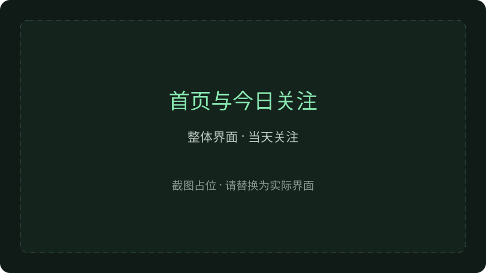
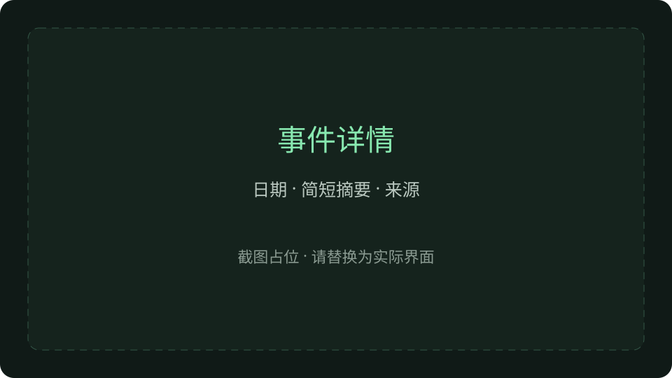
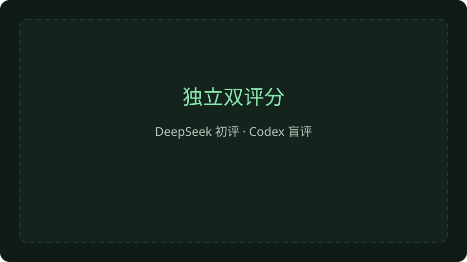
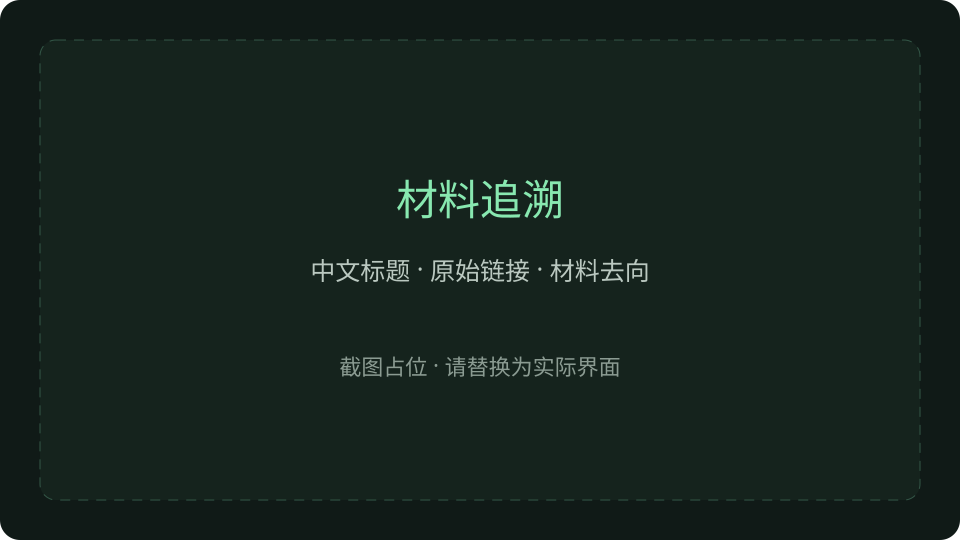
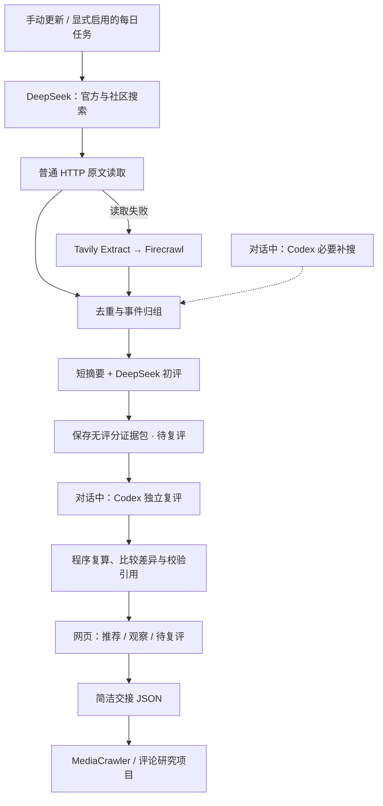

# 游戏事件雷达 · Game Event Radar

从公开消息中找到值得关注的游戏事件：追查原出处、合并重复报道、独立双评分，再把简洁事件包交给评论研究。

这是面向游戏运营与玩家研究的本机工具，不是全网热度榜，也不预测舆情。**崩坏：星穹铁道是首个已验证场景与默认示例**；换游戏需要调整来源、官方账号与查询配置。

## 页面展示

以下是截图占位，后续替换为实际界面截图；不是产品截图。

| 首页与今日关注 | 事件详情 |
| --- | --- |
|  |  |
| 独立双评分 | 材料追溯 |
|  |  |

截图替换方法见 [截图说明](docs/images/README.md)。流程图在下方直接显示，无需截图。

## 解决什么问题

搜索结果很多，但一个标题不等于一个可研究的事件。雷达把“找到消息”推进到“有来源、能筛选、可交接”。

| 问题 | 实现 |
| --- | --- |
| 官宣、转载、爆料混在一起 | 优先官方，保存原链接、日期依据与读取状态；事实与来源说法分开 |
| 同一事件占满搜索结果 | 按主体、行为与时间归组，区分同一次发生、直接后续与仅主题相关 |
| 推荐理由不可检查 | 五维加权评分，DeepSeek 初评 + Codex 独立盲评，保存相同证据快照及差异 |
| 更新失败重头付费 | 缓存、调用回执、阶段断点与有限修复；非法事件隔离，不伪造成功 |
| 资讯和评论研究断开 | 导出事件、日期、来源、已有内容 ID 与少量搜索词，不自动启动采集 |

网站分为 **全部动态 → 精选 → 事件雷达**：全部动态是相关材料；精选按事件选代表材料；事件雷达是聚合后的具体事件或议题。材料去向独立记录为已归入事件、待归组、已排除。

## 工作流程



**自动部分**：DeepSeek 搜索、读取、归组、摘要与初评。定时任务默认关闭，配置后可显式启用北京时间每日 08:00、近 3 天、最多 30 条材料。

**对话部分**：Codex 使用实际搜索工具补查关键缺口，对同一份无评分证据包先保存独立评分，再读取 DeepSeek 分数进行比较。无人值守任务不能冒充已完成 Codex 复评。

每维 0–10 分，总分由程序计算：`影响程度×3 + 信息增量×2 + 证据充分度×2 + 玩家相关面×2 + 可调查性`。两方均推荐且证据资格通过才正式推荐；分歧保留观察，不靠直接平均掩盖问题。分数是选题依据，不是风险概率或客观准确率。

## 两个真实历史案例

| 案例 | 日期 | DeepSeek / Codex | 展示价值 |
| --- | --- | --- | --- |
| [卡芙卡／知更鸟联动](examples/crossover/README.md) | 2026-10-09 | 76 / 67，均推荐 | 跨游戏追查官方出处，区分官宣内容与社区讨论 |
| [真珠体系补强](examples/pearl/README.md) | 2026-09-28 | 57 / 67，均推荐 | 具体体系收益与投入边界可研究；不把攻略估算写成玩家共识 |

案例保留历史证据、两份真实评分和 [交接文件](examples/)；仅重新封装成独立演示数据，没有重新搜索或改分。材料摘要版权归原来源，未知项仍保留。示例不是当前消息。

## 快速启动：无需 API 的演示

环境：Docker Desktop（Linux 容器模式）、Node.js **24.11+**、PowerShell。Docker 首次构建需要下载依赖和镜像。

```powershell
git clone https://github.com/x736260980-ui/game-event-radar.git
cd game-event-radar
./demo.ps1
```

打开 **http://127.0.0.1:8788/**。脚本创建新的本地配置和数据库，启动网页、导入两个历史示例；**不启动每日任务，不调用模型或搜索 API**。再次导入相同示例不会制造新一轮研究。

如果端口已被占用：`./demo.ps1 -Port 8789`。只绑定本机回环地址，不关闭其他程序。停止：`./stop-radar.ps1`，本地数据仍保留。

## 配置后开展实际研究

1. 先启动演示或运行 `./start-radar.ps1`，生成 `engine/.env`。不要提交该文件。
2. 按 [使用说明](docs/usage.md) 配置模型接口与密钥。原生联网搜索使用单独的 DeepSeek 搜索接口设置；普通模型接口不自动等同于具备搜索能力。Tavily、Firecrawl 是正文读取补救，不代替前两路发现。
3. 明确发起一轮研究（会产生供应商 API 用量）：

```powershell
./update-radar.ps1 -RunId my-first-study -Publish
```

自动结果先标记待复评。按 [使用说明](docs/usage.md#独立复评) 交给实际 Codex 对话完成盲评，再发布派生结果。每日任务需另行运行 `./enable-daily-radar.ps1`，新安装默认不启用。

源码安装与检查：

```powershell
cd engine
npm ci
npm run typecheck
npm run build -w @aihot/web
docker compose -f compose.radar.yml --profile test run --rm tests
```

测试历史输入放在仓库内专用 fixtures，不依赖作者本机的运行目录。默认测试命令运行游戏雷达相关测试；非浏览器网页测试使用 `npm run test:web`。

## 项目结构

```text
engine/                 AIHOT 框架与游戏雷达模块
  modules/game-radar/   搜索、读取、归组、双评分、交接、测试
  site/ industry/       站点文案、分类、默认来源配置
examples/               两个历史案例、真实评分、交接 JSON
docs/                   使用说明、验证记录、截图占位
demo.ps1                无 API 演示入口
start-radar.ps1          本机启动
update-radar.ps1         明确发起实际研究
runtime/ runs/           运行后生成，不进入 Git
```

## 与评论研究项目的关系

雷达负责**发现事件**，下游 [game-ops-insight-lab](https://github.com/x736260980-ui/game-ops-insight-lab) 负责 MediaCrawler 评论采集、清洗、分类与运营洞察。交接采用文件，不共用评论统计；网页材料不会被当成评论样本。具体采集仍需在下游确认，雷达不自动触发采集。

## 当前限制

- 部分社区页面有反爬、登录或地域限制；摘要可读不等于正文已读，视频简介也不等于视频内容。
- 语义归组、官方账号识别与模型评分仍可能出错；保留引用、历史和修复记录，不保证全网覆盖。
- 自动更新稳定性受网络、供应商与结构化输出影响；失败保留断点。没有连续观测就不报告热度涨幅。
- Codex 独立搜索与复评需要实际对话执行，不能由 Docker 自动伪造第二位评分者。
- 更换游戏需改来源、官方账号和查询配置；目前只验证星穹铁道。
- `v0.1.0` 是本机使用版本，不是经过公网安全审计的服务；不要直接暴露管理员接口。

## 上游与许可

基于 [AIHOT](https://github.com/KKKKhazix/AIHOT) 开源框架，保留其后端、网页与事件发布基础设施；本项目新增游戏场景发现、证据边界、独立双评分、事件交接与本机流程。未使用 AIHOT 品牌与 Logo。

源码沿用 **MIT**，保留上游版权：[LICENSE](LICENSE)、[NOTICE](NOTICE)。字体沿用 [SIL OFL 1.1](engine/assets/og-fonts/LICENSE)。资料与示例的原文权利仍归来源方，代码许可不授予第三方内容版权。详细复用边界见 [致谢](docs/attribution.md)。
